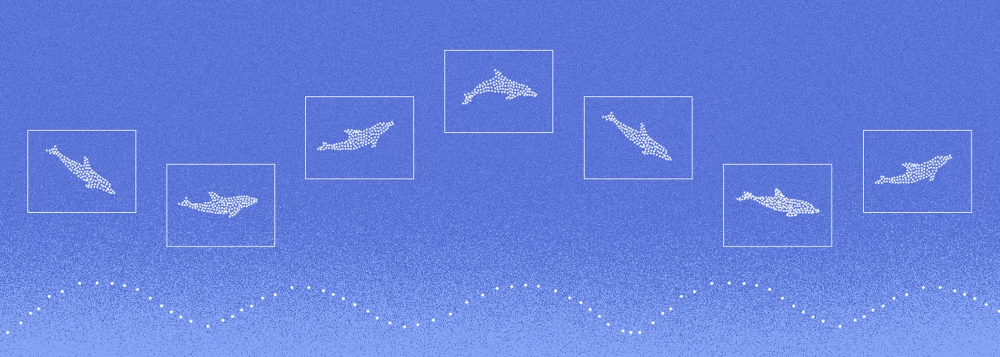

<h1 align="center">Sonar</h1>



Sonar is an inference engine for Hugging Face-compatible language and
multimodal models. It provides continuous batching, paged KV-cache management,
optimized kernels, quantization, speculative decoding, and distributed
serving.

Sonar is based on [vLLM](https://github.com/vllm-project/vllm). It includes
additional model and quantization formats, sampling methods, kernels, platforms,
and deployment features.
It serves production workloads for the
[Dolphin Inference Network](https://datagen.dphn.ai) and
[PygmalionAI](https://pygmalion.chat).

## Documentation

Read the documentation at [sonar.dphn.ai](https://sonar.dphn.ai/).

- [Installation](https://sonar.dphn.ai/getting-started/installation/)
- [Supported models](https://sonar.dphn.ai/reference/models/)
- [Quantization support](https://sonar.dphn.ai/reference/quantization/)
- [Server arguments](https://sonar.dphn.ai/reference/server-arguments/)
- [Optimization](https://sonar.dphn.ai/deployment/optimization/)
- [Parallelism](https://sonar.dphn.ai/deployment/parallelism/)
- [Production deployment](https://sonar.dphn.ai/deployment/production/)

The model, quantization, and server-argument references are generated from the
current source tree.

## Install

Run the automatic installer:

```bash
curl -fsSL https://sonar.dphn.ai/install.sh | bash
```

The installer supports Linux x86-64 (NVIDIA CUDA, AMD ROCm, or CPU), Linux Arm64 (NVIDIA CUDA or CPU), and Apple silicon macOS (Metal).

Use the [complete installation guide](https://sonar.dphn.ai/getting-started/installation/)
for AMD ROCm, Intel XPU, CPU, Apple silicon, Google TPU, Docker, WSL 2, source
builds, and nightly wheels.

## Serve a model

```bash
sonar serve Qwen/Qwen3-0.6B \
  --served-model-name qwen3
```

The server listens on `http://127.0.0.1:2242` by default. It provides
OpenAI-compatible APIs, health checks, metrics, and an OpenAPI schema.

See the [OpenAI-compatible API guide](https://sonar.dphn.ai/serving/openai/)
for streaming, embeddings, tool calls, reasoning output, and Sonar request
parameters.

## Key features

- Continuous batching and paged KV-cache management
- Prefix caching enabled by default
- Tensor, pipeline, data, and expert parallelism
- Multi-node multiprocessing without a Ray cluster
- Prefill/decode disaggregation through NIXL and other KV connectors
- Quantized weights and FP8 KV cache
- Speculative decoding with MTP, EAGLE, DSpark, DFlash, n-gram, and other
  methods
- Structured output, reasoning parsers, and automatic tool calling
- Image, audio, and video model support
- LoRA adapter serving
- Prometheus metrics and health endpoints
- OpenAI, Anthropic, pooling, scoring, reranking, transcription, and Kobold
  APIs

Support depends on the model, device, data type, and quantization method. Check
the generated [model matrix](https://sonar.dphn.ai/reference/models/) and
[quantization matrix](https://sonar.dphn.ai/reference/quantization/) before
deployment.

Read the [optimization guide](https://sonar.dphn.ai/deployment/optimization/)
before you tune scheduler, cache, compilation, quantization, or speculative
decoding settings.

## Development

```bash
git clone https://github.com/dphnAI/sonar.git
cd sonar
uv venv --python 3.13 --seed --prompt sonar
source .venv/bin/activate
SONAR_USE_PRECOMPILED=1 \
  uv pip install --editable . --torch-backend=cu130
```
